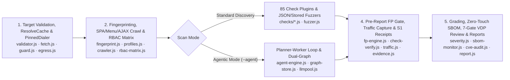

# 🛡️ Security Scanner v2.7 — Autonomous Security Platform & Burp/Invicti Workbench

An autonomous web security verification platform, Burp-class interactive workbench, and CLI scanner built on **Node.js v24 ESM** with embedded **`node:sqlite` + `FTS5`** persistence.

- **85 Built-in Security Checks** across CVEs, injection, modern web, APIs, AI/LLM, supply chain, cloud, headers, CMS, Yii 1/2, and LAN/OS targets
- **77 Web/Runtime + 22 OS/Edge Curated CVE Advisories (`99` Total)** with external CVE DB confirmation, Zero-Touch SBOM Drift Monitoring & Tri-State Docker Labs
- **22 Scan Profiles** (`smart`, `quick`, `api`, `modern`, `device`, `ops`, `nginx`, `apache`, `spring`, `laravel`, `yii`, `wordpress`, `full`, etc.)
- **Zero-Infrastructure** native execution or **`<1s` Docker Live Auto-Sync** (`docker compose`)

---

## 📚 Documentation Hub (Detailed Guides by Menu & Feature)

| Guide | What It Covers |
|---|---|
| **[🔐 Authentication, Visual `.lsr` Recorder, System Variables & TOTP MFA](docs/authentication-and-lsr.md)** | Dedicated **🔐 Login & LSR Studio** tab (`#tab-login-lsr`), **Top Token/Cookie/LocalStorage Harvester & Local Store Checker** (`#top-auth-token-bar`), **System Variables (`{{VAR:name}}`)** & Secrets Vault (`{{SECRET:name}}`), `#lsr-recorder-backdrop` modal, **Top Failure Diagnostics Banner** (all 8 codes), interactive **Visual `Play` Preview**, 6 action types (including `local_storage`/`session_storage` token extraction), and RFC 6238 TOTP MFA |
| **[🖥️ 8-Tab Web UI Dashboard, Menus & Workbenches](docs/web-ui-guide.md)** | Walkthrough of the Header & `🩺 System Doctor` modal plus all 8 tabs: `New Scan` (with Saved Target Systems bar, Top Auth Token/Cookie/LocalStore Bar & compact `.lsr` selector), `Login & LSR Studio`, `Scan Results & Evidence` (including **🧭 Discovered Menus, Submenus & Tested Forms** + RBAC/BFLA filter bar), `Tasks & Sessions`, `Dual-Graph Explorer`, `Traffic & Replay`, `Past Scans & Compare`, and `Checks & System Guardrails` |
| **[📘 User Manual & Saved Target Systems Guide](docs/USER_MANUAL.md)** | Step-by-step operator manual for **Saved Target Systems, 1-Click Configuration Cloner, Scheduled Fix Verification (`Verify Open Issues Only`)**, delta tracking across environments, and `/api/target-systems` REST endpoints |
| **[📦 Runtime SCA, Zero-Touch SBOM, 85-Check Catalog, 22 Profiles & CVE Labs](docs/runtime-sca-and-cve-audits.md)** | Invicti-style **Runtime SCA Findings** (`Identified Version`, `Latest Branch`, `Overall Latest`, `CVSS`, `EOL`), **Zero-Touch SBOM & CVE Drift Monitor** (`GET /api/asm/sbom`), full **22 Profiles** table (including `yii`), complete **85-Check Catalog** tables, `--cve-audit`, `--cve-db`, and Tri-State (`vulnerable` / `patched` / `fp_trap`) CVE Labs |
| **[🌐 Origin IP Discovery, Pinned `--source-ip`, Internal Networks & Devices](docs/network-origin-ip-and-devices.md)** | Discovering origin IPs behind CDN/WAF (`--get-real-ip`, `--scan-real-ip`), `ResolveCache` + `PinnedDialer` (`--source-ip`), authorized RFC1918 scanning (`--allow-private`) & Scope/Deny rules, `--device-category` (`Smart TV`, `IP Camera`, `PC`), and `--pc-local` host auditor |
| **[🧰 CLI Flags, `.secscanrc`, REST API, Agent Mode, LLM Pool & Docker](docs/cli-and-api-reference.md)** | Complete `secscan --help` CLI flag reference, `.secscanrc` config, full `core/server.js` REST API table (including `/api/asm/sbom` & `/api/asm/rbac-audit`), `--agent` mode, Multi-LLM Pool & Ollama setup, 7-Gate VDP Reviewer, 9-Probe Posture Check, Pre-Report FP Gate, and Docker live auto-sync |

---

## ⚡ Quick Start

### 1. Web UI Dashboard (Recommended)
```bash
npm run ui
# or: secscan --ui --port 4321
```
Open `http://127.0.0.1:4321` in your browser (bound strictly to `127.0.0.1` with Host/Origin anti-CSRF validation and CSP hardening).

### 2. CLI Scans
```bash
# Smart tech-stack-aware scan (default) with dark-mode HTML & JSON reports
secscan https://example.com --html --json

# Discover origin IP behind CDN/WAF and scan directly with --source-ip pinning
secscan example.com --scan-real-ip --cve CVE-2026-123007 --html

# Export Markdown, formula-safe CSV, and OASIS SARIF v2.1.0
secscan https://example.com --markdown report.md --csv report.csv --sarif report.sarif

# Autonomous Agent Mode with verification goal & Noise Governor
secscan https://example.com --agent --goal "Verify API auth and headers" --noise-profile quiet

# Authorized internal network or LAN device audit
secscan https://10.20.30.40 --allow-private --scope "allow:10.20.0.0/16,deny:10.20.0.5" --html
secscan 192.168.1.25 --tv

# Local host PC audit, System Doctor, CVE Coverage Audit & Tri-State CVE Labs
secscan --doctor https://example.com
npm run pc:audit
npm run cve:audit
npm run cve:lab
```

### 3. Docker Live Auto-Sync
```bash
npm run docker:up     # Build & start Web UI on http://127.0.0.1:4321 with <1s bind-mount reload
docker compose exec secscan node bin/cli.js https://example.com --html --json
```

---

## 🏗️ Architecture & 5-Stage Data Flow



---

## ✨ Key Feature Highlights

- **Saved Target Systems, 1-Click Configuration Cloner & Scheduled Fix Verification (`core/target-systems.js`)**: Persist reusable target configurations (URL, environment, scan profile, linked `.lsr` login sequence, headers, and recurring schedule), clone an existing system in 1 click to spin up staging/QA targets, track open unfixed check IDs across runs, and execute fast delta re-scans (`Verify Open Issues Only`) or recurring scheduled runs (`hourly`, `every_6h`, `daily`, `weekly`).
- **Invicti Runtime SCA Findings & Zero-Touch SBOM Drift Monitor (`core/runtime-sca.js`, `core/sbom-monitor.js`, `POST /api/sca/analyze`, `GET /api/asm/sbom`)**: Extracts client/server versions from headers, HTML attributes, script URLs, and same-origin JS bundle banners, comparing **Identified Version (Highest CVSS)** against **Latest Branch Version** and **Overall Latest Version** with EOL alerts, plus instant zero-network CVE drift re-evaluation across all historical scan SBOMs.
- **Visual Login Sequence Recorder (`.lsr`), System Variables & RFC 6238 TOTP MFA (`core/auth-session.js`)**: Multi-step `.lsr` flows (`navigate`, `change_input`, `fill_otp`, `click_button`, `extract_token`, `custom_request`), global **System Variables (`{{VAR:name}}`)**, masked **Secrets Vault (`{{SECRET:name}}`)**, **Top Failure Diagnostics Banner** (`8` diagnostic codes), interactive **Visual `Play` Preview**, cross-version Yii 1/2 selector normalization, Restrictions, and Session Detection auto-replay.
- **Deep Post-Login Menu, Dropdown Submenu, SPA `$routeProvider`, JS AJAX & OpenAPI Crawler + JSON/Second-Order Fuzzer (`core/crawler.js`, `core/fuzzer.js`)**: Automatically resolves AngularJS `$routeProvider` `templateUrl` views, `ng-click="selectPage(...)"` menus/submenus, `ng-model` controls, JS controller `$http`/`fetch`/`axios`/`$.ajax` endpoints, and OpenAPI v3/Swagger v2 operations—fuzzing both `application/x-www-form-urlencoded` and `application/json` payloads and verifying second-order (`STORED_REFLECTED`) payloads across views.
- **Automated Multi-Role RBAC & Forced-Browsing (BFLA/BOLA) Access Control Matrix (`core/rbac-matrix.js`, `POST /api/asm/rbac-audit`)**: Re-probes discovered authenticated menus, submenus, SPA views, and forms without session cookies (and optionally with low-privilege `secondaryAuthHeaders`) using an isolated unauthenticated fetcher to detect Broken Function Level Authorization (`CWE-285`) while strictly skipping logout and destructive routes.
- **Invicti Proof-Based Scanning™ & 6-Framework Compliance (`core/compliance-proof.js`)**: Deterministic `0–100%` certainty scoring, structured `proofArtifact` objects, and automatic mapping across **PCI-DSS v4.0**, **OWASP API 2023**, **ISO 27001**, **NIST 800-53**, **SOC 2**, and **HIPAA**.
- **Burp-Class Workbench (`core/intruder.js`, `core/decoder-comparer.js`, `extension/`)**: **Intruder `§marker§`** (4 attack modes), **Autorize** 3-context BOLA/IDOR matrix, 17-op **Decoder & JWT Inspector**, **Response Comparer**, **OpenAPI/Swagger Importer**, **Chrome/Edge CDP Traffic Extension**, and **HAR 1.2** export.
- **Origin IP Discovery & Pinned Source-IP (`core/real-ip-finder.js`, `core/validator.js`, `core/fetch.js`)**: Discovers origin servers behind CDN/WAF (`--get-real-ip`, `--scan-real-ip`) and dials `--source-ip` directly at the socket layer with `Host` + TLS SNI preserved and automatic `--resolve` `curl` reproduction commands.
- **Autonomous Agent Mode, Dual-Graph & Multi-LLM Pool (`core/agent-engine.js`, `core/graph-store.js`, `core/llmpool.js`)**: Planner-worker loop with 19-field Asset Query DSL, Okapi BM25 tool selection, `/btw` read-only side questions, and multi-provider failover (`gemini`, `anthropic`, `openai`, `ollama`) with offline deterministic playbooks.
- **Pre-Report FP Gate, OAST, Sandbox DOM & Host PC Auditor**: `verifyFindingBeforeReport` + Soft-404 shingle filtering (`core/fp-engine.js`), HMAC-tokenized blind OAST callbacks (`core/oast-server.js`), isolated `node:vm` DOM taint verifier (`core/dom-sandbox-verifier.js`), declarative YAML/JSON templates (`core/template-loader.js`), and local host PC security audits (`--pc-local`).

---

## 🧰 Quick Feature Reference Table

| Tool / Capability | CLI Flags | REST API Endpoints | Web UI Controls |
|---|---|---|---|
| **Saved Target Systems, Cloner & Scheduled Fix Verification** | Pass `targetSystemId` in scan requests | `GET\|POST /api/target-systems`, `GET\|PUT\|DELETE /api/target-systems/:id`, `POST /api/target-systems/:id/clone`, `POST /api/target-systems/:id/run` | Tab 1 `#target-systems-quick-bar`, `#target-systems-manager-card`, `#btn-run-target-system-fixes` |
| **Runtime SCA & Zero-Touch SBOM Monitor** | `--check runtime-sca` | `POST /api/sca/analyze`, `GET /api/asm/sbom`, `POST /api/fingerprint` | Tab 2 `#results-runtime-sca-card` + Tab 1 `#tech-detect-sca-row` |
| **Discovered Menus, Submenus, Forms & RBAC/BFLA Matrix** | Automatic on crawled & authenticated scans | `POST /api/asm/rbac-audit`, `GET /api/scan/:id` (`discoveredMenus`, `discoveredForms`, `rbacMatrix`) | Tab 2 `#results-crawl-inventory-card`, `#results-menus-filter-bar`, `#results-menus-tbody`, `#results-forms-tbody` |
| **Visual `.lsr` Recorder, System Variables & TOTP MFA** | `--username`, `--password`, `--login-url`, `--save-session`, `--load-session` | `GET\|POST\|PUT\|DELETE /api/auth/variables`, `GET\|POST\|DELETE /api/auth/sequences`, `POST /api/auth/inspect-page`, `POST /api/auth/otp-preview`, `POST /api/auth/record-session` | `#sys-vars-panel`, `#lsr-reuse-select`, `#btn-open-otp-config`, `#btn-new-lsr-sequence`, `#lsr-recorder-backdrop` |
| **Real / Origin IP & Source-IP Pinning** | `--get-real-ip`, `--scan-real-ip`, `--source-ip <ip>` | `POST /api/real-ip`, `POST /api/scan` (`sourceIp`) | `#get-real-ip-btn`, `#adv-get-real-ip-btn`, `#adv-source-ip` |
| **Device & Local Host PC Auditing** | `--device`, `--tv`, `--camera`, `--pc`, `--device-category`, `--pc-local` | `POST /api/scan` (`deviceCategory`), `GET /api/system/pc-audit` | `#allow-private-toggle`, `#opt-device-category` |
| **Burp Intruder / Autorize / Decoder / Comparer** | `--intruder`, `--payloads`, `--attack-mode`, `--autorize`, `--auth-low` | `POST /api/intruder/run`, `/api/autorize/run`, `/api/tools/decode`, `/api/tools/compare` | Tab 5 **Traffic & Replay** workbenches |
| **OpenAPI Importer & CDP Traffic Extension** | Auto-discovered during API scans | `POST /api/openapi/import`, `POST /api/traffic/ingest`, `GET /api/traffic/export.har` | `#btn-discover-openapi`, `extension/` popup, Tab 5 **Export HAR 1.2** |
| **Proof-Based Scanning & 6-Framework Compliance** | Included in `--json`, `--html`, `--sarif` | `GET /api/scan/:id`, `GET\|POST /api/compliance/summary` | Tab 2 certainty badges, Evidence Drawer & Compliance tags |
| **CVE Audit, External DB & Tri-State Labs** | `--cve-audit`, `--cve-db`, `--cve-lab`, `--new-cve-lab` | `GET /api/cves/coverage`, `POST /api/cves/audit`, `/confirm-db`, `/labs/run` | Tab 7 **🎯 CVE Coverage Audit** |
| **Diagnostics, VDP Review & Posture Check** | `--doctor`, `--review-report`, `--posture-check` | `GET /api/system/doctor`, `POST /api/system/diagnose-target`, `/api/reports/review`, `/api/llm/posture-check` | Header **`🩺 System Doctor`** modal |

---

## 🧪 Running the Test Suite

Run the complete Node.js test suite (`tests/checks/`, `tests/core/`, `tests/ui/`, `e2e/`):

```bash
npm test
```

Verify check discovery and catalog registration:

```bash
node bin/cli.js --list-checks
```

---

## 📁 Project Structure

```
security-scanner/
├── bin/cli.js                  # CLI entrypoint (--ui, --intruder, --autorize, --source-ip, --cve-lab, --pc-local, etc.)
├── checks/                     # 85 modular ESM security check plugins
├── core/                       # Engine modules (auth-session, runtime-sca, rbac-matrix, sbom-monitor, crawler, fuzzer, server, etc.)
├── cve-labs/                   # 10 Tri-State Per-CVE Docker Labs + unified multi-persona gateway
├── docs/                       # Detailed topic guides linked from this README
├── e2e/                        # End-to-end test suite
├── extension/                  # Manifest V3 Chrome/Edge CDP Traffic Capture Extension
├── skills/                     # Modular agent verification methodologies (SKILL.md)
├── templates/                  # Declarative YAML/JSON CVE templates
├── tests/                      # Unit & integration tests (checks/, core/, ui/)
├── ui/                         # 7-tab Web UI Dashboard (index.html, app.js, styles.css, components/)
├── Dockerfile                  # Node 24 Alpine container image
├── docker-compose.yml          # Live auto-sync Docker Compose config (bind mounts + node --watch)
└── scan.js                     # Main Discovery Mode & Agentic Mode orchestrator
```
