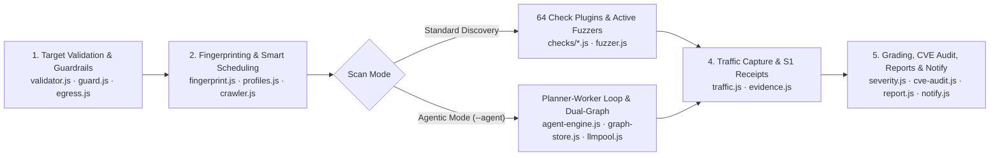

# 🛡️ Security Scanner v2.3

An autonomous web security verification platform and CLI scanner built on **Node.js v24 ESM** with embedded **`node:sqlite` + `FTS5`** persistence — zero external databases, Docker containers, or sidecar services required. Version 2.3 combines **64 Built-in Security Checks**, **20 Scan Profiles**, a **Dual-Audience AI Fix Solution Generator (`--ai-fix`)**, a **System Doctor Diagnostic Engine (`--doctor`)**, a **Missing-CVE Coverage Audit & Registry (`--cve-audit`)**, an **Autonomous Agentic Verification Engine (`--agent`)**, a **Dual-Graph Asset & Exploration Store**, **Machine-Checked S1 Evidence Receipts**, **1-Click Retests**, **Pro Exports (`--sarif`) & Custom Headers (`--header`)**, **Authorized Internal Network Auditing (`--allow-private`)**, and a **7-Tab Interactive Web UI Dashboard**.

Runs across Next.js, React, Vue, Angular, Node.js (Express), Python (Django/Flask/FastAPI), Spring Boot / Java, Apache Tomcat, Laravel, Symfony, Magento, Drupal, CodeIgniter, WordPress, NGINX, and Apache HTTP Server.

---

## 🚀 Overview & Key Capabilities (v2.3)

- **Zero-Infrastructure Node.js v24 ESM Architecture**: Uses Node 24's built-in `node:sqlite` (`DatabaseSync` with `WAL` + `FTS5`) for graph, traffic, and evidence persistence alongside `p-limit` for bounded concurrency — no Docker, Postgres, or Redis needed.
- **64 Built-in Security Checks & 20 Scan Profiles**: Covers operational & system health telemetry (`system-health`), SPA client API communication & external backend discovery (`api-communication`), modern CVEs (`CVE-2026-123007`, `CVE-2026-123633`, `CVE-2026-114938`, `CVE-2025-55182`, `CVE-2025-29927`, `CVE-2025-24813`, `CVE-2024-34102`, `CVE-2024-4577`), ecosystem CVE suites (`cve-nextjs-react`, `cve-spring-framework`, `cve-tomcat`, `cve-apache-httpd`, `cve-wordpress-ecosystem`, `cve-python-web`, `cve-node-express`, `cve-php-ecosystem`), AI/LLM & MCP exposures, Subresource Integrity (SRI), active fuzzing (`xss`, `sqli`, `open-redirect`, `php-lfi`), API security, and framework/CMS audits.
- **SPA API Communication & Backend Discovery (`checks/api-communication.js`, `POST /api/ai/analyze-api`)**: Automatically detects client-side Single Page Application (SPA) API communication patterns across Angular (`HttpClient`), React, Vue, Axios, Fetch, and GraphQL. Inspects HTML and bundled scripts to discover same-origin REST/GraphQL routes and external API origins, verifies Subresource Integrity and CORS, triggers 1-click external backend API scans across the Web UI, and queries the LLM/playbook API advisor for tailored beginner/pro remediation guidance.
- **Dual-Audience AI Fix Solution Generator & Multi-LLM Pool (`--ai-fix`, `--audience beginner|pro`)**: Stack-aware deterministic playbooks (`generatePlaybookFixSolution`) with zero external network or key requirements, optionally upgraded by multi-LLM providers (`gemini`, `anthropic`, `openai`, `openai-responses`, `ollama`) auto-discovered from environment variables (`GEMINI_API_KEY`, `ANTHROPIC_API_KEY`, `OPENAI_API_KEY`, `OLLAMA_HOST`). Offers executive-level "beginner" and engineering-grade "pro" guidance, prompt isolation, secret redaction, interactive UI **🤖 AI Action Roadmap**, per-finding **🤖 AI Fix Solution**, and Evidence Drawer fix patch generator with offline stack playbook fallback.
- **System Health & PC-vs-Target Diagnostics (`--doctor [target]`)**: Preflight environment checks for Node.js (>= 22), native SQLite DatabaseSync, storage directory write permissions, proxy credential masking, active LLM pool profiles, and loaded security check plugins (`GET /api/system/doctor`). Evaluates target connectivity, DNS resolution, SSRF policy, and scope gate diagnostics (`POST /api/system/diagnose-target`) via the CLI or Header **🩺 System Doctor** modal.
- **Pro Exports & Custom HTTP Headers (`--header`, `--sarif`)**: Inject repeatable custom request headers (`--header "Name: Value"`) across discovery and checks, with dedicated UI textarea in Tab 1. Export standard OASIS SARIF v2.1.0 vulnerability reports (`--sarif [file]`, `GET /api/scan/:id/export?format=sarif`, and UI **📋 SARIF** button) for GitHub Advanced Security and CI/CD code scanning integration alongside JSON, HTML, Markdown, and CSV.
- **Missing CVE Coverage Audit & Registry (`--cve-audit`)**: Audits built-in check coverage against **43 curated CVE advisories** (`KNOWN_CVE_ADVISORIES`, including CISA KEV flags), custom JSON advisory catalogs (`--cve-catalog`), tech-stack filters (`--tech`), and optional live CISA KEV / OSV feed syncing (`--cve-feed` with graceful offline fallback). Attaches per-scan CVE coverage summaries to CLI output, JSON/HTML/Markdown reports, and the Web UI.
- **Smart Tech-Stack Fingerprinting (`--profile smart` / `--detect`)**: Identifies 27 frameworks, runtimes, frontend libraries, and servers, then automatically schedules universal + stack-matching checks while skipping irrelevant rules.
- **Autonomous Agentic Verification (`--agent`)**: Planner-worker verification loop with Multi-LLM failover & round-robin worker rotation (`gemini`, `anthropic`, `openai`, `openai-responses`, `ollama`), Okapi BM25 tool selection, `SKILL.md` methodologies, and `/btw` read-only side questions.
- **Dual-Graph Explorer & 19-Field Asset DSL**: Global Asset Graph (with `/24` IPv4 & `/48` IPv6 C-segment grouping and parent host chains) paired with Per-Task Exploration Graphs (`begin -> goal -> intent -> fact -> finding`).
- **Traffic Recording, S1 Evidence Receipts & 1-Click Retests**: Full HTTP capture with SHA-256 content-addressed blob spilling, RFC-9110 request replay, HMAC-tainted rewrite rules, machine-checked S1 proof receipts (`poeLevel >= 3` + verbatim `evidenceQuotes`), automatic **How to Reproduce & Verify Fix** context (secret-redacted `curl` commands, numbered steps, observed signal, and post-fix verification criteria across CLI, JSON/HTML/Markdown/CSV, and UI), and live `reproduced` / `fixed` / `inconclusive` retests.
- **Authorized Internal Network Scanning (`--allow-private`)**: Safely audit internal company servers (`10.x`, `172.16–31.x`, `192.168.x`, `localhost`, `.internal`, `.local`) while keeping cloud metadata guards, DNS-rebinding pinning, and obfuscated-IP blocks strictly enforced.
- **7-Tab Web UI Dashboard (`secscan --ui`)**:
  - **Header** — **`🩺 System Doctor`** modal for live runtime environment triage and target connectivity diagnostics.
  1. `New Scan` — Guided target wizard, stack & SPA API communication preview with 1-click external backend API scan triggers and "🤖 Ask AI About APIs" triage, presets, Custom HTTP Headers (Pro), `--agent` & `--allow-private` toggles, and live SSE progress.
  2. `Scan Results & Evidence` — A+ to F Security Grade, Discovered SPA & Backend API Communication card with 1-click backend scans and "🤖 Ask AI About APIs", **Target CVE Advisory Coverage** (`CVE Coverage Summary`) banner with uncovered advisory pills and `Open CVE Audit` shortcut, **CVSS** / **CVE** finding badges, priority action plan, **`🤖 AI Action Roadmap`**, per-finding **`🤖 AI Fix Solution`**, Simple vs. Developer views, S1 Evidence & Retest drawer with fix patch generator, and JSON/HTML/Markdown/CSV/**SARIF** exports.
  3. `Tasks & Sessions` — Agentic task launcher, intent steering/cancellation, coverage ledger, and `/btw` read-only side questions.
  4. `Dual-Graph Explorer` — Interactive Exploration DAG (with cold-graph folding), Asset Coverage graph, 19-field Asset DSL search, and external scan ingestion (`nmap`, `nuclei`, `httpx`, `ffuf`, `bbot`).
  5. `Traffic & Replay` — FTS5-searchable HTTP exchanges, RFC-9110 Replay editor, and HMAC-tainted Rewrite Rules.
  6. `Past Scans & Compare` — Historical archive with side-by-side scan regression diffs.
  7. `Checks & System Guardrails` — 64-check catalog browser, **`CVE Coverage Audit`** sub-view (KPIs, ecosystem breakdown, KEV/status/search filters, feed sync, and custom advisory JSON audit), New Check Builder scaffolder, Multi-LLM Pool manager, Noise Governor, Scope/Deny rules, and JEV risk evaluator.

---

## 🏗️ How the Application Works (Architecture & Data Flow)



### 1. Target Validation & Guardrails (`core/validator.js`, `core/guard.js`, `core/egress.js`)
- **SSRF & DNS-Rebinding Protection**: `validateTargetUrl` and `resolveAndValidateTarget` block non-HTTP(S) schemes, embedded credentials, backslashes, obfuscated hex/octal/integer IPs, and (by default) private/loopback/internal addresses. `TargetPinStore` pins resolved IPs per hostname across a scan and rejects mid-scan public-to-private DNS rebinding. Redirects are handled manually per hop (`core/fetch.js`) and re-validated at every hop.
- **Scope & Deny Asset Gate (`evaluateAssetGate`)**: Evaluates block-first precedence across built-in high-risk TLD deny rules (`.gov`, `.mil`, `.edu`, `.gov.cn`, `.edu.cn`) and user-configured `allow`/`deny` rules (`exact_domain`, `fuzzy_domain`, `exact_ip`, `fuzzy_ip`, `cidr`, `exact_url`, `fuzzy_url`) both pre-DNS and post-DNS.
- **Target Noise Governor (`NoiseGovernor`)**: Enforces per-host token-bucket rate limits, per-host and global concurrency semaphores, singleflight + TTL `GET` response deduplication, jitter, and automatic `429`/`503` `Retry-After` cooldowns across 4 profiles:
  - `off`: Unlimited RPS / concurrency, `0 ms` cache.
  - `quiet`: `2 RPS/host`, `1` in-flight/host (`8` global), `60 s` GET cache, `50–200 ms` jitter.
  - `balanced` (default in UI): `5 RPS/host`, `2` in-flight/host (`16` global), `30 s` GET cache, `20–80 ms` jitter.
  - `aggressive`: `20 RPS/host`, `4` in-flight/host (`32` global), `10 s` GET cache, `0–20 ms` jitter.
- **Closed-World 8-Question JEV Evaluator & Prompt Isolation**: `decideClosed` evaluates 8 mandatory boolean invariants (`q1_in_scope` through `q8_least_privilege`) and fails closed on missing or false checks. `scoreRisk` scores actions `0–100`, `evaluateInterceptRules` enforces `ALWAYS_ALLOW_DENYLIST` and simple-command parsing, and `wrapDataEnvelope` wraps untrusted target responses in nonce-tagged `[[SECSCAN_DATA nonce=<hex> field=...]]` envelopes.

### 2. Tech Stack Fingerprinting & Smart Scheduling (`core/fingerprint.js`, `core/profiles.js`, `core/crawler.js`)
- **Fingerprinting**: `fingerprint()` inspects HTTP response headers, cookies, HTML DOM patterns, and probe signatures to detect **27 frameworks, frontend libraries, runtimes, and web servers** (`laravel`, `wordpress`, `django`, `rails`, `spring`, `express`, `nextjs`, `drupal`, `magento`, `codeigniter`, `joomla`, `symfony`, `aspnet`, `flask`, `fastapi`, `react`, `vue`, `angular`, `php`, `python`, `node`, `java`, `tomcat`, `nginx`, `apache`, `cloudflare`, `varnish`) and expands them into ecosystem tags (`inferEcosystemTags`).
- **Smart Check Selection**: `selectScannersForStack()` executes all universal checks (`tags: ['all']`) plus checks matching detected ecosystem tags, while skipping non-applicable checks (overridable via `--tech` or `--force-all`).
- **Smart Crawling & Fuzzing**: A concurrent breadth-first crawler (`TaskQueue` + `crawlPage`) discovers same-origin routes up to `--depth` (default `3`). Parameterized active fuzzing checks (`ACTIVE_FUZZING_CHECKS`: `xss`, `sqli`, `open-redirect`, `php-lfi`) run across every crawled route, while domain-level checks run once on the root target.

### 3. Dual-Graph Store, Autonomous Agent Mode (`--agent`) & AI Advisor
- **Dual-Graph Store (`core/graph-store.js`)**: Persists two linked SQLite graphs:
  - **Global Asset Graph**: `companies`, `company_scope`, `assets` (with automatic IPv4 `/24` and IPv6 `/48` `c_segment` calculation and parent host chains `endpoint/service/app -> subdomain/ip -> root_domain`), `task_asset_links`, and `task_scope`.
  - **Per-Task Exploration Graph**: Directed lineage (`begin -> goal -> intent -> fact -> finding`) with atomic lease fencing (`claimIntentToken`, `heartbeatIntentClaim`, `settleIntentClaim`), coverage ledger gap detection, gap-free activity feed, and SHA-256 deduplicated lessons (`rsi_lessons`).
- **19-Field Asset Query DSL (`core/asset-dsl.js`)**: Recursive-descent AST parser compiling boolean expressions (`AND`/`&&`, `OR`/`||`, parentheses, bare search tokens, and `=`, `==`, `!=`, `>`, `>=`, `<`, `<=`) into strictly parameterized SQLite queries across `domain`, `host`, `ip`, `port`, `service`, `protocol`, `url`, `path`, `title`, `status`, `source`, `company`, `c_segment`, `type`, `scope`, `confidence`, `verified`, `severity`, and `finding` (plus `asset`/`key`).
- **Autonomous Agent Engine & Multi-LLM Pool (`core/agent-engine.js`, `core/llmpool.js`, `core/llm-provider.js`, `core/toolrag.js`, `core/skills.js`, `core/sidequestion.js`)**:
  - **Goal Decomposition & Worker Loop**: Decomposes a scan goal into verification intents, executes concurrent workers bounded by `BudgetLedger`, and folds completed older rounds via `core/coldgraph.js`.
  - **Multi-LLM Pool (`LlmPool`)**: Supports `gemini`, `anthropic`, `openai`, `openai-responses`, and `ollama` wire adapters with automatic environment variable discovery (`GEMINI_API_KEY`, `ANTHROPIC_API_KEY`, `OPENAI_API_KEY`, `OLLAMA_HOST`), equal-rank rotation, per-task round-robin worker rotation (`llmRotate`), context-window pre-filtering, quota-aware circuit breaking (treating `402` and billing-exhausted `429` as immediate hard trips; soft-tripping transient errors on a `60s -> 300s -> 1800s` cooldown ladder), and `LlmRecorder` token/cost summaries.
  - **Okapi BM25 Tool Selection & Modular Skills**: `core/toolrag.js` projects the top-K relevant check/agent tools per intent while keeping core write-back tools pinned. Workers can load `SKILL.md` methodologies from `skills/` (`api-recon`, `api-security`, `codeaudit`, `patch-diff`).
  - **`/btw` Read-Only Side Questions (`SideQuestionService`)**: Answers operator questions from a deep-cloned, 4-stage compressed task snapshot with `tools: []` — never mutating active task state or issuing target probes.
- **Dual-Audience AI Fix Advisor (`core/ai-advisor.js`)**:
  - Generates tailored remediation across two audience modes: **`beginner`** (plain-English explanations, high-level impact, and non-technical guidance) and **`pro`** (engineering-grade code diffs, configuration blocks, and exact verification commands).
  - Deterministic stack-aware playbooks (`generatePlaybookFixSolution`) run completely offline with zero API keys or network access.
  - When an LLM pool is configured, `generateFixSolution` and `summarizeScanForAudience` query the pool with strict instruction isolation, stripping control/bidi/invisible characters, redacting credentials (`redactSecretsInText`), wrapping untrusted target evidence in `<untrusted_target_evidence>` tags, and cleanly falling back to the built-in stack playbook on any model or schema failure.

### 4. Traffic Recording, S1 Evidence Receipts & Retest Confirmation (`core/traffic.js`, `core/evidence.js`)
- **TrafficStore (`core/traffic.js`)**: Captures HTTP exchanges in SQLite + `FTS5` full-text search, spilling request/response bodies over `256 KiB` (`INLINE_BODY_LIMIT`) to content-addressed SHA-256 files under `.secscan-history/traffic-blobs/sha256/`. Supports RFC-9110 `replayRequest` (stripping hop-by-hop headers and enforcing SSRF/scope guardrails) and HMAC-SHA256-tainted `RewriteRules` (preserving `original_req_json`).
- **S1 Evidence Receipts (`core/evidence.js`)**: `EvidenceStore` captures immutable snapshots (`evidence_snapshots`), binds proof exchanges (`finding_evidence_bindings`) with staleness tracking (`evidence_version` vs `report_evidence_version`), and verifies S1 receipts (`verifyFindingReceipts`) by requiring:
  - `poeLevel >= 3` (`MIN_VERIFIED_POE_LEVEL`), and
  - At least one verbatim `evidenceQuote` (`>= 8` normalized characters, `MIN_EVIDENCE_QUOTE_LEN`) matched strictly against bound `proof`/`verification` snapshots (including safely decompressed bodies capped at `16 MiB`).
- **1-Click Retests (`retestFinding`)**: Replays the bound proof request under SSRF/scope guardrails and evaluates whether the evidence quotes still match (`reproduced`), no longer appear on a valid response (`fixed`), or could not be determined (`inconclusive`).

### 5. Risk Grading, CVE Coverage Audits, Multi-Format Reporting & Notifications
- **Security Grading (`core/severity.js`)**: Deduplicates findings per `(checkId, status, severity)` and sums weights (`CRITICAL: 20`, `HIGH: 10`, `MEDIUM: 5`, `LOW: 1`, `NONE: 0`) into an **A+ to F** grade:
  - **A+ (`0` pts)**: Outstanding security posture; no vulnerabilities or suspicious findings.
  - **A (`1–4` pts)**: Strong posture with minor low-risk advisories.
  - **B (`5–7` pts)**: Good posture with minor issues to review.
  - **C (`8–19` pts)**: Moderate risk; notable security gaps requiring remediation.
  - **D (`20–39` pts)**: High risk; significant vulnerabilities exposed.
  - **F (`40+` pts)**: Critical security danger; immediate remediation required.
- **Missing-CVE Coverage Audit (`core/cve-catalog.js`, `core/cve-audit.js`)**: Compares built-in check `cveIds` / `partialCveIds` claims against the 43 curated `KNOWN_CVE_ADVISORIES` (plus optional custom JSON catalogs and live CISA KEV / OSV advisory feeds), categorizing advisories into `covered`, `partial`, and `missing` with per-ecosystem coverage percentages and orphan-claim detection. `scan.js` also embeds a compact `cveCoverage` summary (`summarizeCveAudit`) into scan results and reports.
- **Enrichment & Exports (`core/enrich.js`, `core/report.js`, `core/html-report.js`)**: Enriches every finding with CWE, OWASP Top 10 (2021), CVSS v3.1 base score, CVE IDs, proof-strength bullets, and hierarchical asset trees. Exports **JSON**, self-contained dark-mode **HTML**, **Markdown** (with unbalanced-fence closure), formula-safe **CSV** (UTF-8 BOM `\uFEFF` + formula-injection prefix escaping), and OASIS **SARIF v2.1.0** (`generateSarifReport`) for GitHub Advanced Security and CI/CD code scanning integration.
- **Notifications & MCP (`core/notify.js`, `core/mcphttp.js`)**: Dispatches findings across **7 channels** (`webhook`, `slack`, `telegram`, `dingtalk`, `feishu`, `wecom`, `email`) with SSRF validation and secret masking, and connects to external Streamable HTTP (`2025-11-25` / `2025-06-18`) or Legacy SSE (`2024-11-05`) MCP servers.

### 6. System Health Preflight & Diagnostics (`core/system-doctor.js`, `checks/system-health.js`)
- **System Doctor Preflight (`runSystemDoctor`)**: Audits local host environment prerequisites: Node.js runtime (>= 22), native `node:sqlite` DatabaseSync availability, storage directory write permissions (`.secscan-history`, `reports`), proxy configuration and password masking (`maskProxyUrl`), active LLM pool profiles/providers, and 64 loaded check plugins.
- **Target Connectivity & Scope Triage (`diagnoseTarget`)**: Validates target URL syntax, resolves DNS, checks SSRF policy and asset scope gate rules, evaluates latency/HTTP status, and flags reachability issues before executing full scans.
- **Operational Health Check (`checks/system-health.js`)**: Built-in check plugin under Network & Transport probing `/metrics`, `/prometheus`, `/server-status`, `/actuator/health`, server 5xx errors, high response latency (> 3000ms), uncompressed responses, and expiring TLS certificates.

---

## 🏢 Scanning Authorized Internal & Company Applications (`--allow-private`)

By default, Security Scanner **fails closed** against internal and private network targets to protect against SSRF. When you are authorized to audit internal company staging servers, VPN-hosted apps, or local development services (`10.0.0.0/8`, `172.16.0.0/12`, `192.168.0.0/16`, `127.0.0.0/8`, `::1`, `fc00::/7` ULA, `localhost`, `.internal`, `.local`), enable **`--allow-private`** explicitly.

### CLI Examples for Internal Audits

```bash
# Audit an internal staging server on an RFC1918 subnet with HTML + JSON reports
secscan https://10.20.30.40:8443 --allow-private --html --json

# Restrict scope to a company CIDR while denying a sensitive database/admin host
secscan https://portal.corp.internal --allow-private \
  --scope "allow:10.20.0.0/16,deny:10.20.0.5" \
  --auth "Bearer eyJhbGci..." \
  --noise-profile quiet

# Run an authenticated local audit with Autonomous Agent Mode
secscan http://localhost:3000 --allow-private --agent \
  --goal "Verify API auth, CORS, and Next.js middleware controls"

# Fingerprint an internal service without running active checks
secscan http://192.168.10.50:8080 --allow-private --detect
```

### Web UI Workflow for Internal Targets

1. Launch the dashboard with `npm run ui` (or `secscan --ui`).
2. Enable the **"Allow Authorized Internal / Private Network Targets"** toggle:
   - In **`New Scan`**: enables internal/RFC1918/localhost URL validation, fingerprinting (`Detect Tech Stack`), and scan execution.
   - In **`Tasks & Sessions`**: marks newly created agentic tasks with `allowPrivate` so planner/worker probes and tool checks can reach internal hosts.
   - In **`Traffic & Replay`**: allows RFC-9110 request replays against authorized internal exchanges.
   - In **`Scan Results & Evidence`**: allows 1-Click Retests to re-probe the internal target and confirm whether a finding is `reproduced` or `fixed`.

### Confirming Findings with S1 Receipts & 1-Click Retests

1. During a scan or agentic session, HTTP exchanges are captured in `TrafficStore`.
2. Findings with `poeLevel >= 3` and verbatim `evidenceQuotes` (`>= 8` chars) are automatically machine-verified against the bound `evidence_snapshots` (S1 Receipt Verification).
3. After your engineering team patches the internal server, open the **Evidence & Retest** drawer in `Scan Results & Evidence` and click **Retest** (`POST /api/findings/:id/retest`). `EvidenceStore.retestFinding` replays the exact bound proof request against the internal target (with `allowPrivate` + scope rules) and records a verdict of **`reproduced`**, **`fixed`**, or **`inconclusive`**.

### Security Guardrails That Remain Enforced Even With `--allow-private`

Enabling `--allow-private` **never** disables core SSRF hygiene:
- **Cloud Instance Metadata Always Blocked**: IPv4 link-local / metadata `169.254.0.0/16` (including `169.254.169.254`), Alibaba metadata `100.100.100.200`, AWS IPv6 metadata `fd00:ec2::254`, IPv6 link-local `fe80::/10`, unspecified (`0.0.0.0/8`, `::`), multicast (`224.0.0.0/4`, `ff00::/8`), and metadata hostnames (`metadata.google.internal`, `metadata.goog`, `metadata`, `instance-data`).
- **Obfuscated IP Formats Always Blocked**: Single-segment decimal integers (`2130706433`), hex (`0x7f000001`), octal (`0177.0.0.1`), and shorthand dotted notations (`127.1`).
- **Embedded URL Credentials & Authority Confusion Always Blocked**: URLs containing `user:pass@` or backslashes (`\`) before `?`/`#`.
- **Manual Redirect Validation & DNS Pinning**: Every HTTP redirect hop is intercepted and re-checked against metadata/scope/pin rules; `TargetPinStore` still blocks public-to-private DNS rebinding transitions.

---

## 🛠️ How to Add a New Security Check (Developer Guide)

### Step 1: Scaffold the Check & Test File

Use either the CLI scaffolder or the Web UI:

- **CLI**:
  ```bash
  secscan --new-check my-custom-check
  ```
- **Web UI**: Open **`Checks & System Guardrails`** → **`New Check Builder`**, fill in the ID, title, category, tags, plain-English fields, preview the code, and click **Create Check & Unit Test Files**.

This generates `checks/<name>.js` and `tests/checks/<name>.test.js` (names must match `/^[a-z0-9-]{2,40}$/`).

### Step 2: Implement the `checks/<name>.js` ESM Module Contract

`core/registry.js` dynamically loads every `checks/*.js` file and reads `mod.tags`, `mod.meta`, and `mod.default` (`run`).

```javascript
export const tags = ['all']; // or stack tags e.g. ['nginx'], ['java', 'spring'], ['nextjs'], ['ops']

export const meta = {
  id: 'my-custom-check',
  title: 'Example Custom Exposure Check',
  category: 'Secrets & Exposure',
  plainExplanation: 'Checks whether /debug/vars exposes internal runtime metrics.',
  whyItMatters: 'Exposed debug endpoints can leak memory stats, environment data, and internal routes.',
  defaultFix: 'Restrict /debug/vars to localhost or remove debug handlers in production.',
  cwe: 'CWE-200',
  owasp: 'A05:2021-Security Misconfiguration',
  cvssScore: 7.5,
  cveIds: [], // e.g. ['CVE-2026-12345'] if applicable
  references: ['https://cwe.mitre.org/data/definitions/200.html']
};

/**
 * Custom security check runner.
 *
 * @param {string} target
 * @param {Function} fetchWithRetry
 * @param {object} [options={}]
 */
export default async function run(target, fetchWithRetry, options = {}) {
  try {
    const base = target.replace(/\/+$/, '');
    const res = await fetchWithRetry(`${base}/debug/vars`);

    if (res.status === 200 && res.text.includes('"cmdline"')) {
      const quoteMatch = res.text.match(/"cmdline"\s*:\s*\[[^\]]+\]/);
      const evidenceQuotes = quoteMatch && quoteMatch[0].trim().length >= 8
        ? [quoteMatch[0]]
        : [];

      return {
        name: 'my-custom-check',
        status: 'VULNERABLE',       // 'VULNERABLE' | 'SUSPICIOUS' | 'SAFE' | 'ERROR'
        severity: 'HIGH',           // 'CRITICAL' | 'HIGH' | 'MEDIUM' | 'LOW' | 'NONE'
        cwe: meta.cwe,
        owasp: meta.owasp,
        cvssScore: meta.cvssScore,
        cveIds: meta.cveIds,
        path: '/debug/vars',
        detail: 'Debug runtime endpoint /debug/vars is publicly accessible.',
        fix: meta.defaultFix,
        poeLevel: evidenceQuotes.length ? 3 : 2,
        ...(evidenceQuotes.length ? { evidenceQuotes } : {}),
        ...(res.trafficId !== undefined ? { trafficId: res.trafficId } : {})
      };
    }

    return {
      name: 'my-custom-check',
      status: 'SAFE',
      severity: 'NONE',
      detail: 'No exposed /debug/vars endpoint detected.'
    };
  } catch (e) {
    return {
      name: 'my-custom-check',
      status: 'ERROR',
      severity: 'LOW',
      reason: e.message
    };
  }
}
```

### Step 3: Populate S1 Evidence Receipts & Reproduction Context

For `EvidenceStore.verifyFindingReceipts` to mark a finding **`verified`** automatically and give developers full post-fix reproduction context:
1. **Attach `trafficId: res.trafficId`** (when present — `createGovernedFetch` populates `res.trafficId` automatically whenever `TrafficStore` is active).
2. **Set `poeLevel: 3`** (or `4` for critical impact) on `VULNERABLE` findings where proof is directly observed; use `poeLevel: 2` (structural/unconfirmed) or `1` (heuristic) for `SUSPICIOUS` findings.
3. **Provide verbatim `evidenceQuotes`**: Each quote must be **`>= 8` characters** after whitespace normalization and appear **verbatim** in the bound HTTP response headers (`Header-Name: value` or header value) or body (`res.text`). Never fabricate quotes that do not exist in the response!
4. **Reproduction Context (`reproduction`)**: Both `scan.js` and `core/server.js` automatically wrap `fetchWithRetry` with `createTrackedFetch` (`core/reproduction.js`), so non-`SAFE` findings automatically receive structured `reproduction` metadata (`summary`, `method`, `url`, secret-redacted `requestHeaders`, `observedSignal`, shell-safe `curl`, `steps`, `verifyFix`). Checks can also optionally return a `reproduction: { steps, curl, observedSignal, verifyFix }` object to override or customize multi-step reproduction instructions.

### Step 4: Register Metadata, Profiles & Stack Tags

1. **`core/catalog.js` (Required)**:
   - Add the check's entry to `METADATA_ENTRIES` (`id`, `title`, `category`, `plainExplanation`, `whyItMatters`, `defaultFix`, `aliases`).
   - Add the check's ID to `CWE_OWASP_MAP` (`cwe`, `owasp`, `cvssScore`, `cveIds`, `references`).
   - *Note*: `tests/core/enrich-report-notify-mcp.test.js` strictly enforces that **every** file in `checks/*.js` has an entry in both `METADATA_ENTRIES` and `CWE_OWASP_MAP` with valid CWE, OWASP 2021, CVSS (`0–10`), remediation, and references.
2. **`core/profiles.js`**:
   - Add the check ID to relevant `PROFILES` arrays (e.g., `api`, `modern`, `spring`, `ops`, `nginx`, etc.). `smart` and `full` (`checks: null`) discover checks dynamically from `checks/`.
3. **`core/fingerprint.js` (Optional)**:
   - If your check introduces a brand-new technology tag (not already in `TECH_PRIORITY` / `inferEcosystemTags`), add detection patterns to `TECH_SIGNATURES` and update `TECH_PRIORITY`, `CATEGORY_MAP`, and `TECH_DISPLAY_NAMES`.

### Step 5: Write Unit Tests & Verify

Write tests in `tests/checks/<name>.test.js` covering **`VULNERABLE`**, **`SUSPICIOUS`** (if applicable), **`SAFE`**, **`ERROR`**, and **S1 receipt verification** (passing `evidenceQuotes` + `poeLevel: 3` + `trafficId` through `TrafficStore` / `EvidenceStore.verifyFindingReceipts` or `assessFindingVerification`).

Verify everything before committing:
```bash
# Run full test suite (all check & core tests)
npm test

# Verify check discovery & catalog registration
node bin/cli.js --list-checks

# Syntax check new files
node --check checks/my-custom-check.js
```

---

## Quick Start

### 1. Web UI Dashboard (Recommended)
```bash
npm run ui
# or: secscan --ui --port 4321
```
Open `http://127.0.0.1:4321` in your browser. The local server binds strictly to `127.0.0.1` with Host/Origin anti-CSRF validation and CSP hardening.

### 2. CLI Scans
```bash
# Smart tech-stack-aware scan (default) with dark-mode HTML & JSON reports
secscan https://example.com --html --json

# Export Markdown, formula-safe CSV, and SARIF v2.1.0 reports
secscan https://example.com --markdown report.md --csv report.csv --sarif report.sarif

# Pass repeatable custom HTTP headers alongside Authorization
secscan https://api.example.com --header "X-Tenant-ID: staging" --header "X-Debug: true" --auth "Bearer eyJ..."

# Generate AI / playbook remediation guidance for a specific audience (beginner | pro)
secscan https://example.com --ai-fix --audience beginner

# Standalone tech-stack detection & profile recommendation (no active checks)
secscan https://example.com --detect

# Autonomous Agent Mode with custom verification goal & Noise Governor
secscan https://example.com --agent --goal "Verify API auth and headers" --noise-profile quiet

# Authorized internal network audit with CIDR allow/deny scope
secscan https://10.20.30.40 --allow-private --scope "allow:10.20.0.0/16,deny:10.20.0.5" --html

# Authenticated API audit
secscan https://api.example.com --profile api --auth "Bearer eyJ..."

# Compare with last scan to find regressions
secscan https://example.com --diff
```

### 3. Preflight Diagnostics, CVE Coverage Audit & Maintenance Tools
```bash
# Run local preflight health check (Node runtime, SQLite, storage, LLM pool, checks)
secscan --doctor

# Run preflight triage including target connectivity and SSRF/scope gate checks
secscan --doctor https://example.com

# List all 64 checks with categories and tags
secscan --list-checks

# List all 20 scan profiles
secscan --profiles

# Run operational & system health audit profile
secscan https://example.com --profile ops

# Audit built-in check CVE coverage (offline curated catalog)
secscan --cve-audit

# Export CVE coverage audit as JSON (stdout), Markdown, or formula-safe CSV
secscan --cve-audit --json
secscan --cve-audit --markdown cve-audit.md
secscan --cve-audit --csv cve-audit.csv

# Filter by tech stack, load a custom CVE catalog, sync live feed, and fail CI on gaps
secscan --cve-audit --tech nextjs,spring --cve-catalog advisories.json --cve-feed --fail-on-missing-cves

# Scaffold a new check plugin and unit test suite
secscan --new-check my-custom-check
```

### 4. Using a Local LLM (Ollama, LM Studio, vLLM, LocalAI)

Security Scanner runs **deterministic stack-aware playbooks** offline by default, and can connect directly to your **local LLM** for live AI remediation, SPA/API triage, and `--agent` planning without sending scan data to the cloud.

#### Option A — Environment Auto-Discovery (Ollama — CLI & Web UI)
Set `OLLAMA_HOST` (defaults model to `llama3.1`) and optionally `SECSCAN_OLLAMA_MODEL`:

```powershell
# PowerShell (Windows)
$env:OLLAMA_HOST = "http://127.0.0.1:11434"
$env:SECSCAN_OLLAMA_MODEL = "qwen2.5-coder:7b"   # optional, default: llama3.1

# Verify local LLM detection in System Doctor
node bin/cli.js --doctor

# Analyze SPA/Angular API communication or scan with local AI remediation
node bin/cli.js https://your-app.com --detect --ai-fix
node bin/cli.js https://your-app.com --ai-fix --audience pro
node bin/cli.js --ui
```

```bash
# Bash / macOS / Linux
export OLLAMA_HOST="http://127.0.0.1:11434"
export SECSCAN_OLLAMA_MODEL="qwen2.5-coder:7b"
secscan --doctor && secscan https://your-app.com --ai-fix --audience pro
```

#### Option B — Configure via Web UI (Ollama, LM Studio, vLLM, llama.cpp)
1. Start the dashboard (`npm run ui` or `node bin/cli.js --ui --allow-private`).
2. Open **Tab 7 (`Checks & System Guardrails`) → `🧠 Multi-Provider LLM Pool & Breakers`**.
3. Under **Add / Update LLM Profile**:
   - **For Ollama**: select **`ollama (Local)`**, enter ID (e.g. `local-ollama`), Model (e.g. `llama3.1`, `qwen2.5-coder`), leave Base URL blank for `http://127.0.0.1:11434` (or enter custom URL), leave API Key blank, and click **Save LLM Profile**.
   - **For LM Studio / vLLM / llama.cpp OpenAI-compatible servers**: select **`openai (OpenAI-compatible)`**, set Base URL (e.g. `http://127.0.0.1:1234/v1`), set Model to your loaded model name, enter any dummy API Key (e.g. `lm-studio`), and click **Save LLM Profile**.
4. Your local model is now active across **🤖 Ask AI About APIs** (`POST /api/ai/analyze-api`), **🤖 AI Action Roadmap** (`POST /api/ai/summary`), **🤖 AI Fix Solution** (`POST /api/ai/remediate`), and **Tab 3 `Tasks & Sessions` (`--agent`)**.

---

## CLI Reference

```
Usage: secscan <url> [options]
       secscan --doctor [url...] [options]
       secscan --cve-audit [options]
       secscan --ui [--port 4321]
       secscan --new-check <name>
       secscan --list-checks

Preflight & Diagnostics:
  --doctor                  Check runtime, storage, proxy, LLM pool, and optional target connectivity

Web Dashboard:
  --ui                      Launch interactive Web UI Dashboard
  --port <port>             Port for Web UI server            (default: 4321)

CVE Coverage Audit:
  --cve-audit               Audit built-in scanner checks against CVE advisories
  --cve-catalog <file>      Load custom CVE advisory catalog JSON file
  --cve-feed                Sync optional online advisory feed (graceful offline fallback)
  --fail-on-missing-cves    Exit 1 if any evaluated CVE advisories are missing coverage

Maintenance & Scaffolding:
  --new-check <name>        Scaffold a new check plugin and test suite
  --list-checks             List all 64 security checks with metadata

Scan Options:
  --detect, --fingerprint   Detect tech stack and profile recommendation only (no scan)
  --force-all               Run all security checks regardless of detected tech stack
  --allow-private           Allow authorized internal/private network targets (blocks cloud metadata)
  --json                    Save JSON report (or stdout JSON in --cve-audit / --doctor mode)
  --html                    Save HTML report (dark-mode, self-contained)
  --markdown [file]         Save Markdown report (optional output filename)
  --csv [file]              Save CSV report (optional output filename, UTF-8 BOM + formula-safe)
  --sarif [file]            Save SARIF v2.1.0 report (default: secscan-report.sarif)
  --ai-fix                  Generate AI / playbook fix solutions and audience summary
  --audience <beginner|pro> Target audience for --ai-fix guidance (default: pro)
  --header "Name: Value"    Custom HTTP request header (repeatable)
  --output <stem>           Base name for reports            (default: report)
  --profile <name>          Scan profile (20 profiles; default: smart; see Scan Profiles table)
  --profiles                List all 20 available profiles
  --depth <n>               Crawl depth for discovery (0..5, default: 3)
  --tech <list>             Force tech tags, comma-separated (e.g. react,node,laravel)
  --concurrency <n>         Parallel targets                 (default: 5)
  --timeout <ms>            Request timeout in ms            (default: 10000)
  --auth <token>            Authorization header value
  --diff                    Compare with last scan and show changes
  --no-history              Do not save this scan to history
  --webhook <url>           Send results to Slack/webhook URL
  --agent                   Run AgentEngine planner-worker verification loop
  --goal <text>             Custom verification goal for --agent mode
  --noise-profile <p>       NoiseGovernor profile: off|quiet|balanced|aggressive
  --scope <rule>            Scope allow/deny rule (repeatable or comma-separated)
```

Create a `.secscanrc` JSON file in your project root (`core/config.js`) to persist default options (`targets`, `concurrency`, `timeout`, `profile`, `output`, `json`, `html`, `markdown`, `csv`, `sarif`, `aiFix`, `audience`, `headers`, `auth`, `webhook`, `noHistory`, `maxDepth`, `port`, `ui`, `forceAll`, `techOverride`, `agent`, `goal`, `noiseProfile`, `scopeRules`, `allowPrivate`, `cveCatalog`, `cveFeed`, `failOnMissingCves`).

---

## Web UI API Endpoints (`core/server.js`)

| Method & Path | Purpose |
|---|---|
| `GET /api/meta` | Version, scan presets, profiles, CVE coverage summary, and full 64-check catalog |
| `GET /api/system/doctor` | Local environment preflight, storage permissions, proxy, and LLM pool status check |
| `POST /api/system/diagnose-target` | PC-vs-target preflight triage (DNS resolution, SSRF/scope gate, ping latency) |
| `POST /api/ai/remediate` | Generate dual-audience fix solution (AI-enhanced or offline stack playbook fallback) |
| `POST /api/ai/summary` | Generate executive/developer scan summary for target audience (`beginner` \| `pro`) |
| `POST /api/ai/analyze-api` | Ask LLM or deterministic playbook about discovered SPA API communication, backend endpoints, and hardening guidance |
| `GET /api/cves/coverage` | Audit built-in check CVE coverage (supports `?tech=...` and `?feed=1`) |
| `POST /api/cves/audit` | Evaluate custom CVE advisory JSON arrays (`{ advisories, techTags, includeFeed }`) |
| `POST /api/fingerprint` | Tech stack fingerprinting and check selection preview |
| `POST /api/scan` / `GET /api/scan/:id` / `GET /api/scan/:id/stream` | Launch scan, inspect status, and stream live SSE events |
| `GET /api/scan/:id/export?format=json\|html\|markdown\|csv\|sarif` | Export scan, history, or task findings in any format (including OASIS SARIF v2.1.0) |
| `GET /api/history` / `GET /api/history/:id` / `POST /api/diff` | Browse past scans and compute regression diffs |
| `POST /api/report/html` | Generate standalone dark-mode HTML report |
| `POST /api/checks/scaffold` | Preview (`dryRun`) or create new check + test files |
| `GET\|POST /api/tasks`, `GET /api/tasks/:id`, `PUT /api/tasks/:id/llm` | List/create agent tasks, view graph/coverage, configure LLM chain |
| `POST /api/tasks/:id/plan`, `/sidequestion`, `/intents/:nodeId/steer\|cancel` | Plan next round, ask `/btw` side question, steer or cancel intents |
| `GET /api/graph/exploration/:taskId`, `/coverage`, `/lineage/:taskId/:findingId` | Inspect Exploration DAG (with `?fold=true`), Asset Coverage, and Finding Lineage |
| `GET /api/assets?dsl=...`, `POST /api/assets/ingest` | Query assets with 19-field Asset DSL; ingest `nmap`/`nuclei`/`httpx`/`ffuf`/`bbot` |
| `GET /api/findings/asset-tree`, `GET\|POST /api/findings/:id/evidence`, `POST .../verify\|retest` | Asset-grouped findings, S1 evidence binding/verification, and 1-Click Retests |
| `GET /api/traffic`, `/hosts`, `/:id`, `POST /api/traffic/:id/replay`, `/ingest`, `GET\|POST\|DELETE /api/traffic/rewrite-rules` | FTS5 traffic search, RFC-9110 replay, external ingest, and HMAC rewrite rules |
| `GET /api/llm/pool`, `POST /api/llm/profiles`, `POST .../reset`, `DELETE /api/llm/profiles/:id` | Multi-LLM pool status (`gemini`, `anthropic`, `openai`, `ollama`), profile CRUD, and circuit breaker reset |
| `GET\|PUT /api/guard/settings`, `POST /api/guard/evaluate` | Noise Governor, Scope/Deny rules, Intercept rules, and JEV / risk evaluator |

### Web UI Dashboard Highlights & Pro Features
- **Header**: **`🩺 System Doctor`** button opens the diagnostic modal to inspect local Node runtime, SQLite, storage directory write permissions, proxy status, LLM pool profiles, and run instant PC-vs-target connectivity/SSRF preflight triage.
- **Tab 1 (`New Scan`)**: Features guided target wizard, stack preview, presets, **Custom HTTP Headers** (`custom-headers-input`, one `Name: Value` per line) for authenticated scans, `--agent` & `--allow-private` toggles, and live SSE progress.
- **Tab 2 (`Scan Results & Evidence`)**:
  - **`🤖 AI Action Roadmap`**: Opens executive (`beginner`) or engineering (`pro`) action summaries prioritized by risk.
  - **`🤖 AI Fix Solution`**: Per-finding AI/playbook remediation buttons providing tailored remediation instructions and configuration snippets.
  - **Evidence Drawer & Fix Patch Generator**: Detailed request/response trace inspection, S1 proof verification, live 1-Click Retest, and code/config patch generation with offline stack playbook fallback.
  - **Pro Exports**: Download findings in JSON, self-contained HTML, Markdown, formula-safe CSV, or **`📋 SARIF`** (OASIS SARIF v2.1.0) format.
  - **Target CVE Advisory Coverage**: Banner showing covered/partial/missing KPIs, uncovered advisory pills, and an **Open CVE Audit** shortcut.
- **Tab 7 (`Checks & System Guardrails` → `CVE Coverage Audit`)**: Dedicated `ui/components/cve-coverage.js` sub-view featuring KPI cards, interactive ecosystem breakdown, status (`All` / `Missing` / `Partial` / `Covered`) and text filters, `?tech=` stack filtering, optional live `?feed=1` advisory sync, and custom JSON advisory catalog upload/audit (`POST /api/cves/audit`).

---

## Scan Profiles (20 Profiles in `core/profiles.js`)

| Profile | Description |
|---|---|
| `smart` | **[DEFAULT]** Smart Auto-Detect — fingerprints the site tech stack first and runs universal + matching technology checks |
| `quick` | Fast scan of the highest-impact checks only (~5–10s) |
| `ops` | System health, telemetry, TLS, headers, and operational stability audit |
| `nginx` | NGINX web server & HTTP/2 reverse proxy security audit (`CVE-2026-123007`, `CVE-2026-123633`, headers, TLS) |
| `apache` | Apache HTTP Server & proxy CVE security audit (`cve-apache-httpd`, headers, directory listing) |
| `spring` | Spring Boot / Java application security audit (Actuators, `CVE-2026-114938` Java4Shell, `cve-spring-framework`, `cve-tomcat`, JWT, API checks) |
| `modern` | Modern Web, Next.js, Node, AI/LLM, SRI Supply-Chain & NGINX HTTP/2 audit |
| `cms` | CMS & E-Commerce audit (WordPress, Laravel, Magento, Drupal, PHP) |
| `api` | REST & GraphQL API security audit — CORS, rate limiting, JWT, auth routes, AI/LLM, Spring/Tomcat, Next.js/Node/Python, NGINX/Java CVEs |
| `laravel` | Full Laravel application audit (Ignition, Debug, Livewire, Storage, Telescope, Auth, Env Manipulation, `cve-php-ecosystem`) |
| `wordpress` | WordPress site security audit (`wp-checks`, `cve-wordpress-ecosystem`, PHP/server checks) |
| `magento` | Magento / Adobe Commerce audit (CosmicSting `CVE-2024-34102` and admin exposure) |
| `drupal` | Drupal CMS security audit (EOL detection and exposure checks) |
| `codeigniter` | CodeIgniter framework audit (`CVE-2025-54418` and exposure checks) |
| `symfony` | Symfony framework security audit (`_profiler`, debug routes, `cve-php-ecosystem`, PHP checks) |
| `php` | Generic PHP application audit (`php-version`, `phpunit-rce`, `php-lfi`, `php-cgi-exposure`, `cve-php-ecosystem`, `symfony-checks`, etc.) |
| `frontend` | Modern Frontend (React, Angular, Vue, Next.js) & SRI Supply-Chain audit |
| `node` | Node.js / Express & Next.js security audit (`node-checks`, `cve-node-express`, `cve-nextjs-react`) |
| `python` | Python (Django / Flask / FastAPI) security audit (`python-checks`, `cve-python-web`) |
| `full` | All 64 checks — comprehensive audit across every framework |

---

## Security Check Catalog (64 Checks)

### Known Vulnerabilities (CVEs)
| Check ID | Category | Description |
|---|---|---|
| `cve-2026-123007` | Known Vulnerabilities | NGINX HTTP/2 Flow-Control Heap Overflow (`ngx_http_v2_module`, passive ALPN/Alt-Svc + version check) |
| `cve-2026-123633` | Known Vulnerabilities | NGINX HTTP/2 Upstream Proxy Use-After-Free (passive HTTP/2 + upstream proxy signal check) |
| `cve-2026-114938` | Known Vulnerabilities | Java4Shell Base64 AVX-512 Heap Overflow (passive headers & Spring Actuator runtime/arch check) |
| `cve-2024-4577` | Known Vulnerabilities | PHP CGI Argument Injection RCE (Windows PHP-CGI) |
| `cve-nextjs-react` | Known Vulnerabilities | Next.js & React Server Components CVEs (`CVE-2025-55182` React2Shell, `CVE-2024-34351` Server Actions SSRF, `CVE-2024-46982` SSR cache poisoning) |
| `cve-spring-framework` | Known Vulnerabilities | Spring Boot & Spring Framework CVEs (`CVE-2024-38816`, `CVE-2024-38819`, `CVE-2025-22235`, `CVE-2024-22262`) |
| `cve-tomcat` | Known Vulnerabilities | Apache Tomcat CVEs (`CVE-2025-24813` partial-PUT RCE, `CVE-2024-50379` PUT race RCE, `CVE-2025-31650` HTTP/2 DoS) |
| `cve-apache-httpd` | Known Vulnerabilities | Apache HTTP Server CVEs (`CVE-2024-38476`, `CVE-2024-38477`, `CVE-2024-39573`, `CVE-2024-27316` HTTP/2 CONTINUATION flood) |
| `cve-wordpress-ecosystem` | Known Vulnerabilities | WordPress Core & Plugin CVEs (`CVE-2024-10924` Really Simple Security auth bypass, `CVE-2024-4439`, `CVE-2024-6307`) |
| `cve-python-web` | Known Vulnerabilities | Python Web Ecosystem CVEs — Django & Starlette/FastAPI (`CVE-2024-45230`, `CVE-2024-53907`, `CVE-2025-26699`, `CVE-2024-47874`) |
| `cve-node-express` | Known Vulnerabilities | Node.js & Express Ecosystem CVEs — express, ws, axios (`CVE-2024-29041`, `CVE-2024-43796`, `CVE-2024-37890`, `CVE-2025-27152`) |
| `cve-php-ecosystem` | Known Vulnerabilities | PHP, Laravel & Symfony Ecosystem CVEs (`CVE-2025-1217`, `CVE-2025-27515`, `CVE-2024-50342`) |
| `magento-cosmicsting` | Known Vulnerabilities | Magento / Adobe Commerce CosmicSting XXE (`CVE-2024-34102`) |
| `phpunit-rce` | Known Vulnerabilities | PHPUnit `/vendor/phpunit/.../eval-stdin.php` RCE (`CVE-2017-9841`) |

### Active Attack & Injection Checks
| Check ID | Category | Description |
|---|---|---|
| `xss` | Injection & Input | Reflected Cross-Site Scripting via query/body parameters |
| `sqli` | Injection & Input | Error-based and Time-based Blind SQL Injection |
| `sql-errors` | Injection & Input | Verbose MySQL, PostgreSQL, SQLite, and MSSQL error disclosure |
| `open-redirect` | Input Validation | Unvalidated redirect parameters (`?url=`, `?redirect=`, etc.) |
| `php-lfi` | Injection & Input | Local File Inclusion via directory traversal payloads |

### Modern Web, API, AI & Supply Chain
| Check ID | Category | Description |
|---|---|---|
| `nextjs-checks` | Framework Security | Next.js `CVE-2025-29927` middleware bypass, Server Actions & SSR leaks |
| `ai-llm-exposure` | AI & Machine Learning | Unauthenticated OpenAI, Anthropic, Ollama, LangChain, Vector DB & MCP endpoints |
| `sri-supply-chain` | Supply Chain Security | External CDN scripts/stylesheets missing Subresource Integrity (`integrity` hashes) |
| `spring-checks` | Framework Security | Exposed Spring Boot Actuator endpoints (`/actuator/env`, `heapdump`, `beans`) |
| `frontend-checks` | Information Disclosure | Exposed `.js.map` source maps, dev-mode leaks, and hardcoded API tokens |
| `node-checks` | Framework Security | Exposed `package.json`, `node_modules`, and `X-Powered-By: Express` |
| `python-checks` | Framework Security | Django/Flask debug mode, Werkzeug debugger, and `requirements.txt` exposure |
| `api-endpoints` | API Security | Exposed internal API routes, debug routes, and Swagger/OpenAPI docs |
| `api-communication` | API Security | Discovers Single Page Application (SPA) client-side API communication, framework clients (Angular HttpClient, Axios, Fetch), same-origin REST/GraphQL endpoints, external backend API origins, and bundles |
| `graphql` | API Security | GraphQL schema introspection enabled in production |
| `cors` | API Security | Overly permissive CORS (`*` or reflected `Origin` with credentials) |
| `rate-limit` | API Security | Burst probe testing for missing HTTP `429` rate limiting |

### HTTP Headers, Transport, Auth & Secrets
| Check ID | Category | Description |
|---|---|---|
| `ssl-tls` | Network & Transport | Expired certificates, hostname mismatch, weak TLS 1.0/1.1 protocols |
| `http-redirect` | Network & Transport | Missing automatic HTTP-to-HTTPS (301) redirection |
| `system-health` | Network & Transport | Operational telemetry (/metrics, /prometheus, /server-status, /actuator/health), server 5xx errors, latency, compression & expiring TLS |
| `security-headers` | HTTP Headers | Missing HSTS, CSP, `X-Content-Type-Options`, `X-Frame-Options`, `Referrer-Policy` |
| `clickjacking` | HTTP Headers | Missing `X-Frame-Options` or CSP `frame-ancestors` protection |
| `http-methods` | HTTP Headers | Dangerous or unnecessary HTTP methods (`PUT`, `DELETE`, `TRACE`, `OPTIONS`) |
| `cookie-security` | Authentication & Session | Missing `Secure`, `HttpOnly`, and `SameSite` flags on cookies |
| `jwt-security` | Authentication & Session | `alg: none` flaws, weak secrets, and exposed JWT token endpoints |
| `admin-panels` | Access Control | Publicly exposed admin login panels (`/admin`, `/administrator`, `/cpanel`) |
| `directory-listing` | Information Disclosure | Open web server directory indexing |
| `env` | Secrets & Exposure | Exposed `.env` / `.env.backup` files containing secrets |
| `git` | Secrets & Exposure | Exposed `.git` repository directory and `.git/HEAD` |
| `sensitive-files` | Secrets & Exposure | Exposed SQL dumps, `.zip` archives, backups, and `docker-compose` configs |
| `robots-sitemap` | Information Disclosure | Sensitive hidden routes leaked in `robots.txt` or `sitemap.xml` |
| `server-disclosure` | Information Disclosure | Detailed server software/version banners in `Server` headers |

### PHP, Laravel, Symfony & CMS Checks
| Check ID | Category | Description |
|---|---|---|
| `ignition` | Framework Security | Laravel Ignition debug RCE (`CVE-2021-3129`) |
| `laravel-auth` | Framework Security | Laravel login/registration/password-reset CSRF and rate-limit checks |
| `laravel-debug` | Framework Security | Laravel `APP_DEBUG=true` stack-trace & secret exposure |
| `laravel-env-manipulation` | Framework Security | Laravel query-string environment manipulation (`CVE-2024-52301`) |
| `laravel-livewire` | Framework Security | Exposed Livewire `/livewire/update` & `/upload-file` endpoints |
| `laravel-storage` | Framework Security | Publicly accessible `storage/logs`, caches, and session files |
| `laravel-telescope` | Framework Security | Publicly accessible `/telescope` debugging dashboard |
| `php-backup` | Information Disclosure | Forgotten `.bak`, `.old`, and `~` PHP source backup files |
| `php-cgi-exposure` | Framework Security | Exposed `/fpm-ping`, `/php-status`, or `cgi-bin` PHP binaries |
| `php-config` | Framework Security | Unsafe PHP directives (`allow_url_include`, `display_errors`, `register_globals`) |
| `php-errors` | Information Disclosure | Verbose PHP warnings, notices, and fatal error stack traces |
| `php-info` | Information Disclosure | Public `phpinfo.php`, `info.php`, or `test.php` pages |
| `php-version` | Information Disclosure | Disclosed PHP version via `X-Powered-By` and EOL detection |
| `wp-checks` | CMS Security | WordPress user enumeration, `xmlrpc.php`, `wp-config` backups, and debug logs |
| `drupal-checks` | CMS Security | Drupal EOL version detection, `CHANGELOG.txt`, and admin paths |
| `magento-checks` | CMS Security | Magento admin URLs, `/downloader`, and `local.xml` exposure |
| `codeigniter-checks` | Framework Security | CodeIgniter `CVE-2025-54418`, writable logs, and system folder exposure |
| `symfony-checks` | Framework Security | Symfony `_profiler` WebProfiler toolbar and debug route exposure |

---

## Test Suite

Run the complete Node.js test suite (`node --test`):

```bash
npm test
```

The test suite across `tests/checks/`, `tests/core/`, `tests/ui/`, and `e2e/` covers:
- Every check plugin under `VULNERABLE`, `SUSPICIOUS`, `SAFE`, `ERROR`, and S1 evidence receipt verification.
- SSRF, DNS-rebinding pinning, `--allow-private` & metadata blocking, Scope/Deny rules, Noise Governor, and 8-question JEV invariants.
- Embedded Dual-Graph Store, 19-field Asset DSL compilation, AgentEngine planner-worker loop, Multi-LLM pool rotation & circuit breaking, TrafficStore FTS5 + replay, EvidenceStore S1 receipts + retests, catalog CWE/OWASP parity across all 64 checks, CVE catalog & coverage audits, reporting exports (including SARIF v2.1.0), notifications, MCP HTTP client, and live Web UI / API endpoints.
- End-to-end integration tests (`e2e/01-cli-and-config.e2e.mjs` through `e2e/06-pairwise-and-scenarios.e2e.mjs`) exercising CLI flows, SSRF/scanning, server API & UI components, CVE checks, CVE coverage audits, and pairwise scenarios.

---

## Project Structure

```
security-scanner/
├── bin/
│   └── cli.js                  # CLI entrypoint (--ui, --agent, --doctor, --cve-audit, --allow-private, --new-check, etc.)
├── checks/                     # 64 modular ESM security check plugins (including system-health.js and api-communication.js)
├── core/
│   ├── agent-engine.js         # Planner-worker verification loop & goal decomposition
│   ├── ai-advisor.js           # Dual-audience AI/playbook remediation generator, API analyzer & secret redaction
│   ├── api-discovery.js        # Bounded SPA/Angular JS bundle & runtime config API endpoint discovery
│   ├── asset-dsl.js            # 19-field Asset Query DSL tokenizer, parser & SQLite compiler
│   ├── budget.js               # Hierarchical agent tool-call budget ledger
│   ├── catalog.js              # 64-check metadata catalog, CWE/OWASP/CVSS map & check scaffolder
│   ├── coldgraph.js            # Cold exploration graph folding & digest expansion
│   ├── config.js               # .secscanrc configuration loader & merger
│   ├── crawler.js              # Concurrent same-origin link discovery
│   ├── cve-audit.js            # Missing-CVE coverage audit engine, KEV/OSV feed sync & formatters
│   ├── cve-catalog.js          # 43-advisory curated CVE catalog, schema validator & JSON loader
│   ├── cve-utils.js            # Shared CVE version/range comparators, HTTP/2 & Java4Shell signal helpers
│   ├── egress.js               # Target Noise Governor (rate limit, concurrency, GET dedup)
│   ├── enrich.js               # Finding/asset enrichment, banner sanitization & external tool ingestion
│   ├── evidence.js             # S1 EvidenceStore, snapshot binding, receipt verifier & 1-click retests
│   ├── fetch.js                # Governed HTTP fetch & TLS ALPN probe with manual redirect validation
│   ├── fingerprint.js          # 27-tech stack fingerprinter & ecosystem tag inference
│   ├── fuzzer.js               # Active parameter fuzzing engine (XSS, SQLi)
│   ├── graph-store.js          # Embedded node:sqlite Dual-Graph Store (Assets + Exploration DAG)
│   ├── guard.js                # Scope/Deny AssetGate, TargetPinStore, JEV, InterceptRules & data envelopes
│   ├── headers.js              # Shared RFC 7230 & hop-by-hop custom HTTP header validator
│   ├── history.js              # Scan history persistence & regression diff engine
│   ├── html-report.js          # Self-contained dark-mode HTML report generator
│   ├── llm-provider.js         # Wire adapters for gemini, anthropic, openai, openai-responses & ollama
│   ├── llmpool.js              # Multi-LLM failover pool, circuit breaker & round-robin worker rotation
│   ├── llmrec.js               # LLM token usage & cost recorder
│   ├── mcphttp.js              # Streamable HTTP & Legacy SSE MCP client with SSRF protection
│   ├── notify.js               # 7-channel notification dispatcher with secret masking & SSRF guard
│   ├── profiles.js             # 20 scan profiles & smart stack check selector
│   ├── queue.js                # Discovery crawl queue
│   ├── registry.js             # Dynamic ESM check plugin loader
│   ├── reproduction.js         # Request trace capture, secret-safe curl & post-fix reproduction builder
│   ├── report.js               # JSON, Markdown, CSV (BOM + formula-safe), SARIF v2.1.0 & proof-strength reporting
│   ├── server.js               # Localhost-hardened HTTP/SSE Web UI & REST API server
│   ├── severity.js             # Deduplicated risk scoring & A+ to F Security Grade calculator
│   ├── sidequestion.js         # /btw snapshot-forked read-only side question service
│   ├── skills.js               # SKILL.md registry & frontmatter parser
│   ├── system-doctor.js        # System doctor preflight & PC-vs-target diagnostic triage
│   ├── toolrag.js              # Okapi BM25 lexical tool selector
│   ├── traffic.js              # SQLite + FTS5 TrafficStore, blob spilling, RFC-9110 replay & rewrite rules
│   └── validator.js            # SSRF URL validation, metadata guards & DNS-rebinding resolution
├── e2e/                        # End-to-end test suite (01–06 *.e2e.mjs + test server/CLI helpers)
├── skills/                     # Modular agent verification methodologies (SKILL.md)
│   ├── api-recon/
│   ├── api-security/
│   ├── codeaudit/
│   └── patch-diff/
├── tests/
│   ├── checks/                 # Unit tests for check plugins
│   ├── core/                   # Core engine, security regression, CVE audit & API tests
│   ├── helpers/                # Shared test mocks (mock-fetch.js)
│   └── ui/                     # Frontend UI component unit tests (ui-components.test.js)
├── ui/
│   ├── components/             # Modular UI views (Session, Graph, Traffic, Guardrails, cve-coverage.js, etc.)
│   ├── app.js                  # Frontend state, SSE client & tab controller
│   ├── index.html              # 7-tab Web UI Dashboard shell
│   └── styles.css              # Dashboard styling
├── scan.js                     # Main Discovery Mode & Agentic Mode orchestrator
├── package.json
└── README.md
```
